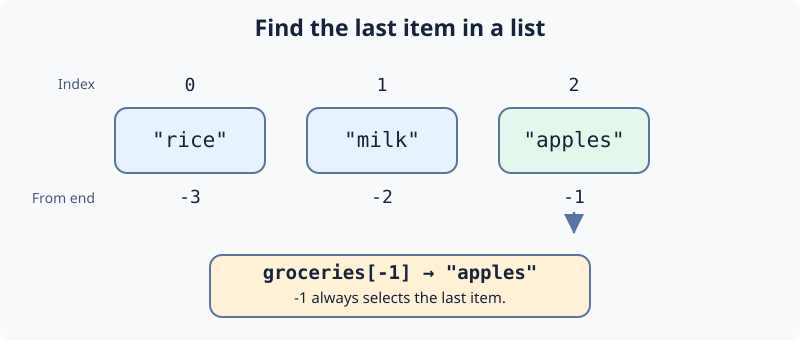

A grocery list has an order: the first item is the one you plan to pick up first. In Python, a list puts values between square brackets. Each value has an index, starting at `0`. A negative index counts back from the end, so `groceries[-1]` reads the last item. This works like indexing a string, but returns a whole list item rather than one character.

`len(groceries)` gives the number of items. Reading an index outside the list raises `IndexError`. For an empty list, there is no last item.

The starter reads the first item. In `main.py`, change the index to read the last one. Press **Run** to see `apples`, then **Submit** to check your change.

## Your Task

1. Set `last_item` to the last item in `groceries`.
