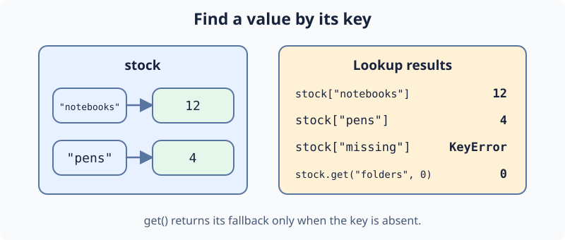

A shop records quantities by product name. In a dictionary, each key points to a value: `"notebooks"` points to `12` notebooks in stock. You read `stock["notebooks"]` without needing to know the order of the entries. Assigning to `stock["pens"]` changes that product's count.

A bracket lookup for a missing key raises `KeyError`. Use `stock.get("folders", 0)` to return zero if folders have no entry. This does not add folders to the dictionary.

The starter reads the pen count instead of the notebook count. Edit `main.py` to read notebooks. **Run** should print `12`, then `Pens: 9` and `Folders: 0`. **Submit** to check your lookup.

## Your Task

1. Read `stock["notebooks"]` into `notebook_count`.
